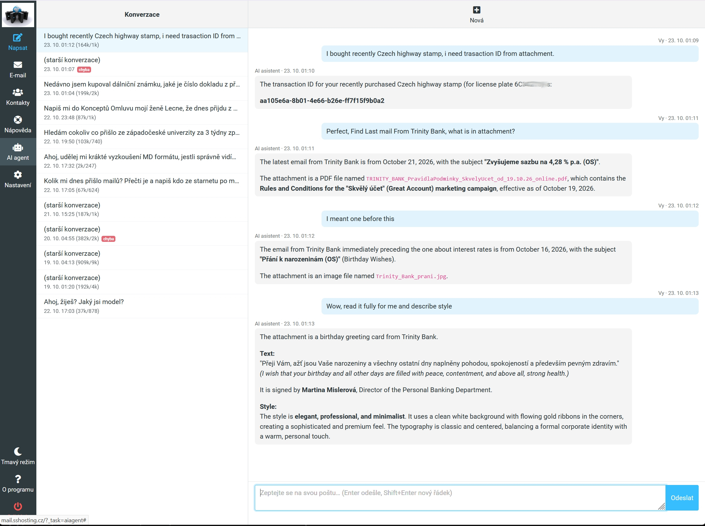
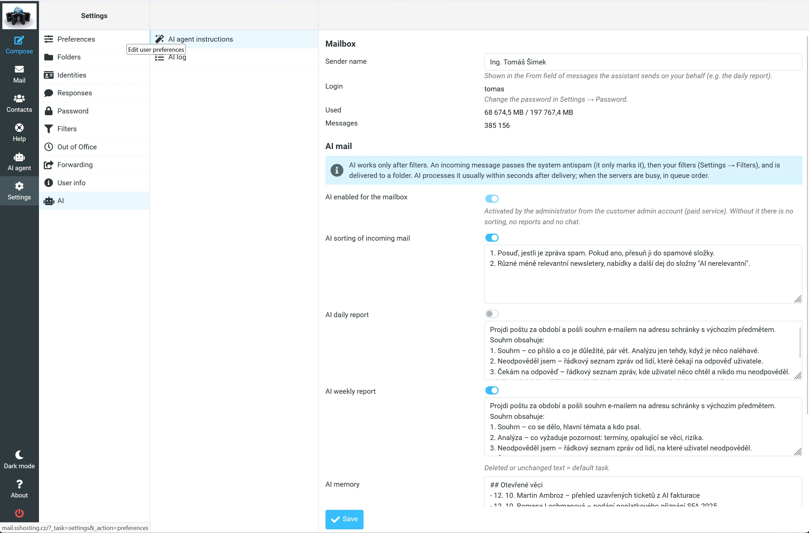
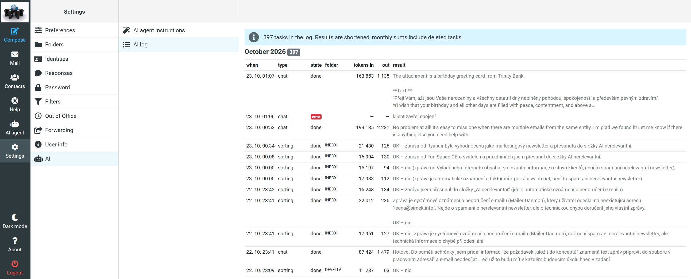

# AI agent plugin for Roundcube

**A Roundcube plugin for an AI agent working over your mailbox: chat with
it, let it write and check your mail, give it instructions and see what it
did, right inside Roundcube.**

Ask *"what important came this week?"* or *"find the last invoice from my
provider and summarize it"*. The agent searches and reads your mail and
answers in Markdown, and it can open the message it found for you. Click
**AI write** or **AI reply**, say what you want, and the agent drafts the
message and opens it in the compose editor. **AI spell check** in the
editor corrects the text in place. Nothing is ever sent by the agent.

Besides that, users can switch on AI sorting of incoming mail and daily
or weekly reports, write their own instructions for each agent and their
own writing style, edit what the assistant remembers about them and see a
log of everything the AI did, including token usage.

All the work happens **on the server**. Incoming mail is sorted when it
is delivered, whether or not any client is running: webmail closed, a phone
app, a desktop client or no client at all. Reports are sent the same way.
The plugin is only the window into it: chat, settings and the log.



> **Sorry, the screenshots are partly in Czech.** They come from a real
> mailbox in daily use, so the mail, the instructions and the memory are
> Czech. In the chat above the interface is Czech too. The chat also shows
> why that does not matter: the questions are in English, the mail is in
> Czech, and the agent finds the mail, reads the attachments and answers
> in English, translating where needed.

## Built for SSHosting, made for anyone

The plugin was written by [Tomáš Šimek](https://simek.info) for
[SSHosting](https://sshosting.cz). It runs in production at
[SSHosting](https://sshosting.cz) and [STARNET](https://starnet.cz), on top
of an AI agent that works with real mailboxes.
It is not tied to that backend, though. The design follows today's common
patterns, and on the wire it is a combination of two simple things:

1. **The OpenAI Chat Completions API** (`/v1/chat/completions`, SSE
   streaming, standard `tools`) with two small additions: a server-side
   session carried in the `X-Conversation-Id` header and the chat type in
   `X-Chat-Type`.
2. **A small REST-like data API**: one URL, the operation in `?fn=`,
   JSON responses and a Bearer token. Seven operations cover login and
   logout, mailbox settings, the task list, conversation history and usage
   sums.

Both are fully specified in [`config.inc.php.dist`](config.inc.php.dist).
Implement them over any agent you like: an LLM with IMAP tools, a local
model, a ticketing system or anything else. The plugin talks to nothing
else, with no database access and no daemons.

### Our backend

At SSHosting and STARNET the stack behind the plugin is Exim and Dovecot for
mail, **Stanban Agent** as the AI agent and an API built on the
[**Waggle**](https://github.com/shimmi2/waggle) framework. The admin portal,
where administrators enable AI for mailboxes, is written on Waggle too.
Waggle and Stanban Agent are my own technologies, written for the AI era.
If you are building an agent for your plugin backend, I am open to
consultations on the implementation: [simek.info](https://simek.info).

## Features

- **AI agent** in the main menu: the conversation window with the list of
  past conversations next to it, live streaming, a stop button and
  continuing older conversations. It uses the responsive layout of the
  Elastic skin.
- **Messages in the chat.** When the agent talks about a message, it can
  open it in a window over the chat; *Open in Mail* then shows it in the
  folder list.
- **AI write** and **AI reply** in the mail toolbar (reply needs one
  selected message): a window asks what and how to write, the agent drafts
  the message and the page switches to the compose editor with recipients,
  subject and text filled in (a reply keeps the usual quote). The
  conversation stays in the chat history.
- **AI spell check** in the compose toolbar: the editor content is sent
  by itself, the corrected text replaces it (HTML stays HTML, the
  signature stays), with a summary of the changes and a *revert to the
  original text* link. You can go on in the window, e.g. *"make it more
  formal"*.
- **Settings → AI → AI agent instructions**: switches for AI sorting of
  incoming mail and for daily and weekly reports with the next and last
  run, custom instructions for each agent (falling back to defaults),
  general style for AI reply, AI write and AI spell check, and the
  assistant's memory, which the user can edit.
- **Settings → AI → AI log**: every AI task by month with its state,
  folder, input and output tokens and result, plus monthly sums.
- Clear notices for a mailbox or domain without the service: it is
  either not purchased, or it has to be activated by an administrator.
- Elastic skin with dark mode. English and Czech.

| AI agent instructions | AI log |
|---|---|
|  |  |

## How it works

```
 Browser ──── chat (SSE), conversation list ─────────────────┐
    │                                                        ▼
 Roundcube + ai_agent ── login, settings, log (server side) ─► Data API ─► your AI agent
```

- **Login.** The plugin logs in to the API with the same username and
  password the user used for Roundcube (`do_login`). It gets a token that is
  valid for **this mailbox only** and keeps it in the Roundcube session. The
  password is never stored. On expiry (401) the plugin logs in again, and
  logging out of Roundcube calls `do_logout`.
- **Settings and log** are called by the plugin on the server.
- **The chat** is called by the browser directly, because an agent's answer
  can take minutes and is streamed. The API therefore has to send CORS
  headers. The token travels in a header and no cookies are used, so
  `Access-Control-Allow-Origin: *` is safe.
- **Client tools.** Opening a message, filling the compose editor and
  replacing its content happen in the browser, so the server cannot do
  them. The plugin sends their definitions in the standard `tools` field;
  the agent offers them to the model but does not run them, it returns
  the calls (`finish_reason: tool_calls`). The plugin runs them, answers
  `OK` or the error as `role: tool` messages and the model continues. At
  most 5 tool rounds per question. Which tools a window offers depends on
  where it is: the spell check gets only the editor replacement, the other
  windows everything else. The tools never send anything.
- **Answers are Markdown** that may quote foreign mail. They are rendered
  with [marked](https://github.com/markedjs/marked) and always sanitized
  with [DOMPurify](https://github.com/cure53/DOMPurify). Links open in a new
  window without an opener.

## Installation

With Composer, from the Roundcube directory:

```
composer require shimmi2/ai-agent
```

The Roundcube plugin installer puts the plugin into `plugins/ai_agent`,
offers to enable it and creates `config.inc.php` from the `.dist` file.

Without Composer:

```
git clone https://github.com/shimmi2/roundcube-ai-agent.git
roundcube-ai-agent/install.sh /path/to/roundcube    # [--web-group www-data]
```

Then add `'ai_agent'` to `$config['plugins']` in `config/config.inc.php`.

## Configuration

`plugins/ai_agent/config.inc.php`:

| option | meaning |
|---|---|
| `ai_agent_api_url` | base URL of the data API, e.g. `https://api.example.com/` (required) |
| `ai_agent_chat_url` | base URL of the OpenAI-compatible chat; `null` = `<api_url>v1/` |
| `ai_agent_model` | model name sent in chat requests (default `mail-ai`); our agent ignores it |

## Implementing the backend

The full specification is in [`config.inc.php.dist`](config.inc.php.dist).
In short:

| operation | method | purpose |
|---|---|---|
| `do_login` / `do_logout` | POST | exchange mailbox credentials for a per-mailbox token / end it |
| `mail_get_mailbox` | GET | mailbox info, AI switches, instructions with defaults, memory |
| `mail_store_mailbox` | POST | store the fields the user may change |
| `ai_list_tasks` | GET | tasks with state and tokens; `type=chat` = conversations to return to |
| `ai_get_conversation` | GET | turns of one conversation, including tool calls and results |
| `ai_usage_months` | GET | monthly task and token sums |
| `chat/completions` | POST | OpenAI chat, SSE, client `tools`; session in `X-Conversation-Id`, type in `X-Chat-Type` |

The service labels (for example a paid service activated by an
administrator) follow the SSHosting model. If your model differs, adjust
them in `localization/`.

## Requirements

- Roundcube 1.7 with the Elastic skin (developed and tested on 1.7.5)
- PHP 8.1 or newer
- an HTTPS backend implementing the API above

Two JavaScript libraries are used for the chat, and both are bundled in
`js/`. In the old terms they are statically linked, so there is nothing to
install and no CDN to load them from:

- [marked](https://github.com/markedjs/marked) 12.0.2 (MIT) renders
  Markdown;
- [DOMPurify](https://github.com/cure53/DOMPurify) 3.4.17 (Apache-2.0 or
  MPL-2.0) sanitizes the answers.

## Known limitations

- Dates and numbers in the AI log use a fixed format (`23. 10. 14:05`,
  `12 345`), not the user's locale.
- Only the Elastic skin is supported.
- *Open in Mail* selects the message in the list only when it is on the
  first page of the folder.

## License

Author: [Tomáš Šimek](https://simek.info).

GPL-3.0-or-later, see [LICENSE](LICENSE). For the bundled libraries see
[`js/README.md`](js/README.md).
