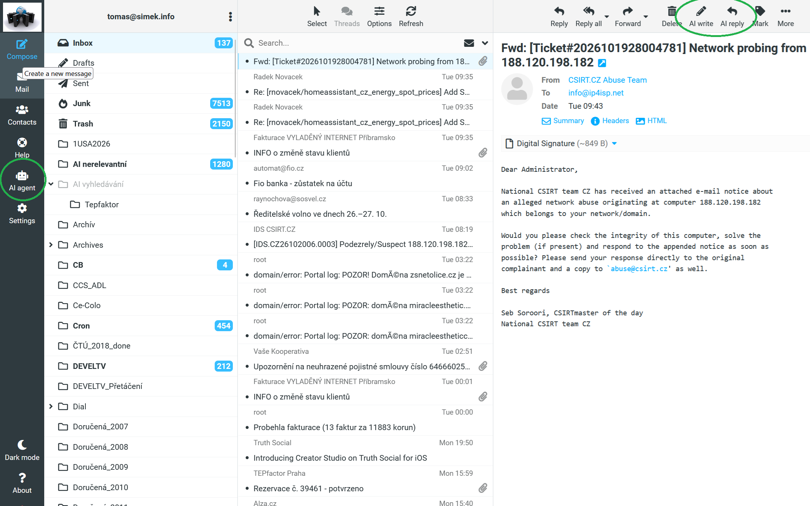
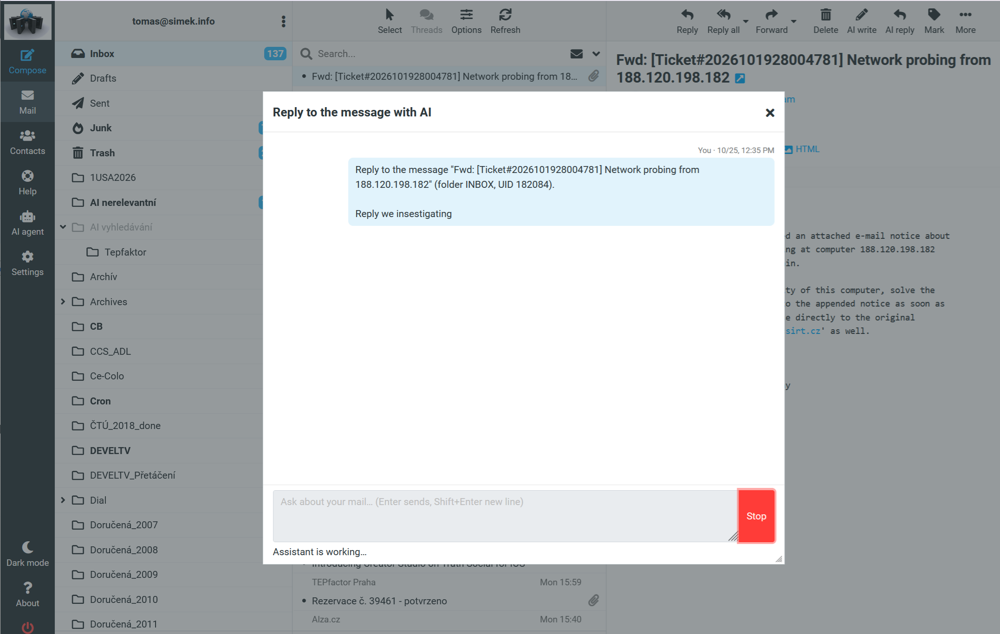
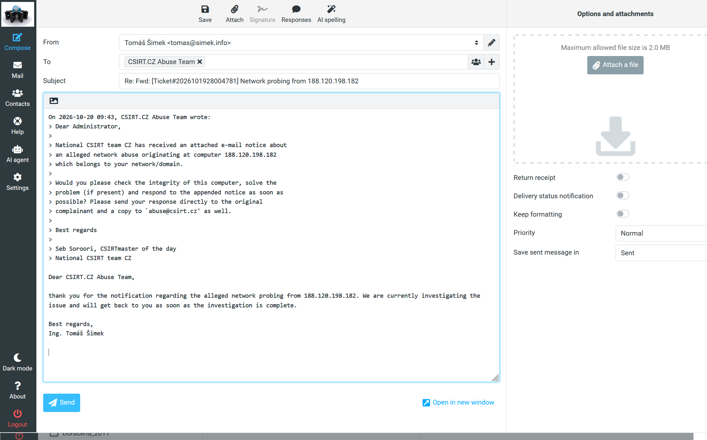
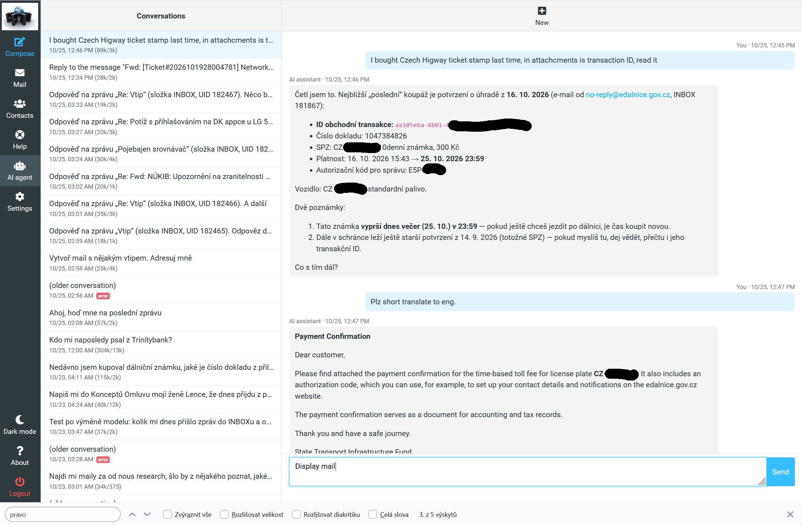
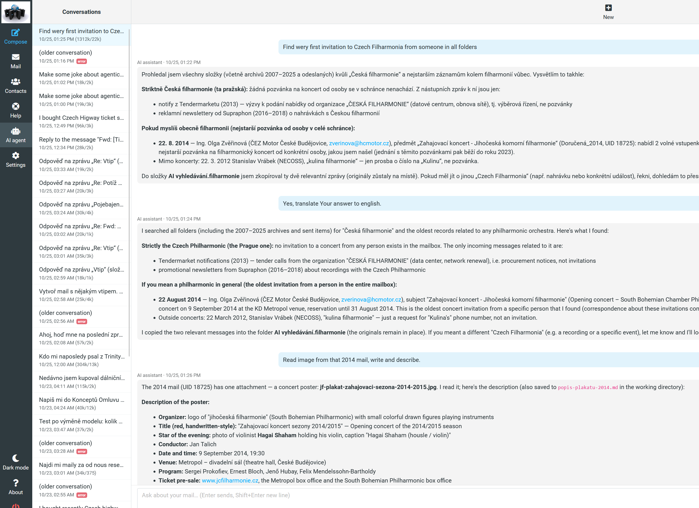
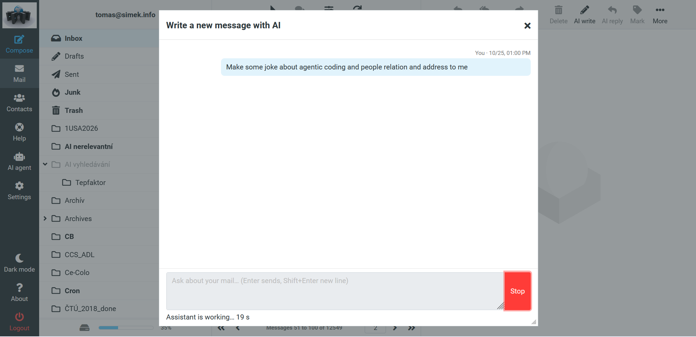
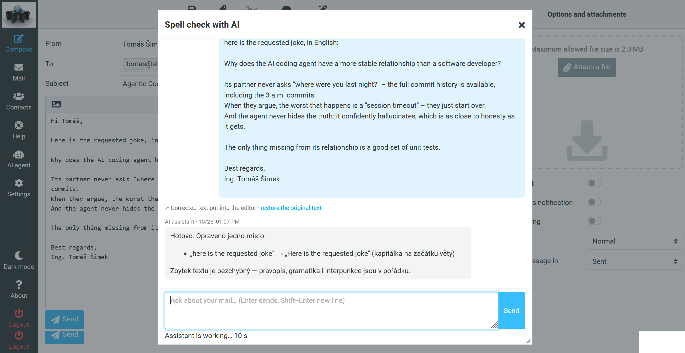
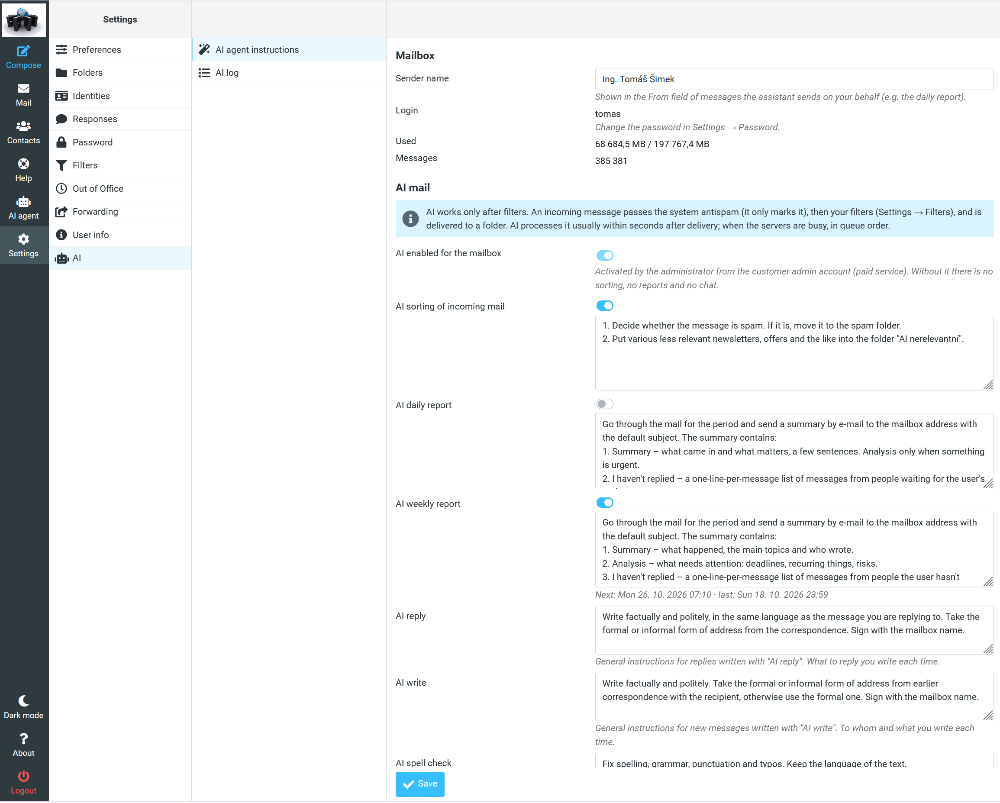
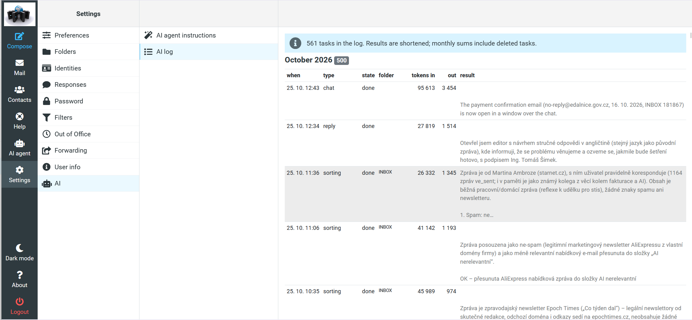

# AI agent plugin for Roundcube

**A Roundcube plugin for a centralised AI agent over the mail of your
company (or your hosting):**

- **Fights spam and sorts mail on the server**, immediately during
  delivery and according to your instructions, whether or not any mail
  client is running.
- **Writes daily and weekly summaries:** what you forgot to answer and who
  has not answered you, what important or unfinished happened during the
  week, and so on.
- **Does what ordinary agents do, too:** corrects, replies to or creates a
  message with one button, following your standing instructions.
- **Controls Roundcube while you talk to it.** *"Find the mail from my wife
  and show it"* works, and so does *"find it and write an answer"*: the
  reply window opens, prefilled from your words. Nothing is ever sent by
  the agent.
- **Logs everything:** a precise log of all actions and their token cost.

> **Sorry, the screenshots are partly in Czech.** They come from a real
> mailbox in daily use. The interface is in English, but the mail and the
> folder names are Czech, and the agent's memory says that the user
> communicates primarily in Czech, so it answers in Czech unless asked
> otherwise. The screenshots also show why that does not matter: questions
> in English over Czech mail are found, read and answered, and translated
> on request.

## Features

### AI in the mail view



**AI agent** in the main menu opens the chat. **AI write** and **AI reply**
in the mail toolbar start a message with the agent; AI reply needs one
selected message.

### AI reply



A window over the mail asks what and how to write. A few words are
enough, typos included (*"Reply we insestigating"*). The agent reads the
original message, drafts the reply and the page switches to the compose
editor:



Recipient and `Re:` subject as with a normal reply, the quote of the
original, the reply below it in the language of the original message and
signed with the mailbox name. The general style (formal or informal,
signature, tone) comes from the user's settings, the content from the
request. Sending is up to you. The conversation stays in the chat history.

### Chat with the agent



The conversation list with token usage on the left; live streaming, a stop
button and continuing older conversations. The agent searches and reads
the mail including attachments and answers in Markdown. When it talks
about a message, it can show it: *"Display mail"* opens the message in a
window over the chat, and *Open in Mail* shows it in the folder list.



It searches all folders, here archives back to 2007, explains what it
found and what it did not, copies the results into a search folder, reads
an image attachment (a concert poster from 2014) and saves the
description to its working directory.

### AI write and AI spell check



**AI write** works the same way as AI reply, for a new message: say to
whom and what, and the agent opens the editor with the recipients,
subject and text filled in.



**AI spell check** in the compose toolbar sends the editor content by
itself. The corrected text replaces it (HTML stays HTML, the signature
stays), the window lists what was changed and *restore the original text*
takes it back. You can go on in the window, e.g. *"make it more formal"*.
The spell checks are not kept in the conversation list.

### Settings → AI → AI agent instructions



- Switches for AI sorting of incoming mail and for daily and weekly
  reports, each with its own instructions (falling back to defaults). The
  reports show when they run next and when they last ran; the schedule is
  set by the administrator.
- General style for AI reply, AI write and AI spell check. What to write
  is given each time; here is how.
- The assistant's memory, which the user can read, correct or delete.
- Clear notices for a mailbox or domain without the service: it is
  either not purchased, or it has to be activated by an administrator.

### Settings → AI → AI log



Every AI task by month: when, type (sorting, reports, chat, reply, write,
spell check), state, folder, input and output tokens and the result, plus
monthly sums.

Elastic skin with dark mode. English and Czech.

## How it works

This repository is the **Roundcube plugin**, the most complex part from
the user's point of view: the chat, the windows over the mail and the
editor, the settings and the log. It talks to nothing but two HTTPS APIs.
Behind them there are three more parts:

- **The agent**, which runs an LLM in a loop with tools: reading and
  searching the mailbox, moving and copying messages, reading
  attachments, sending reports.
- **The data API and the chat API**: login, settings, the task log,
  conversation history; the chat in the OpenAI format.
- **The model**, any OpenAI-compatible endpoint.

All of it is wired to the mail system. Sorting starts from the mail
server at delivery and reports are planned on the server, so they work
with the webmail closed, with a phone app, a desktop client or no client
at all.

```
 Browser
┌──────────────────────┐  chat (SSE), tool calls   ┌──────────┐     ┌───────┐     ┌───────┐
│                      │──────────────────────────►│ Chat API │────►│ agent │────►│ model │
│ Roundcube + ai_agent │                           └──────────┘     └───┬───┘     └───────┘
│                      │  login, settings, log     ┌──────────┐         │ ▲
│                      │──────────────────────────►│ Data API │         ▼ │ delivery hook
└──────────────────────┘                           └────┬─────┘     ┌─────────────┐
                                                        ▼           │ mail server │
                                                ┌──────────────┐    │ IMAP, SMTP  │
                                                │ SQL: access, │◄───┤             │
                                                │ settings,    │    └─────────────┘
                                                │ prompts, logs│
                                                └──────────────┘

               ·  company admin board in the Waggle framework  ·
```

The chat goes from the plugin's script in the browser, the data API calls
from the plugin on the Roundcube server. All the data, the mail and the
SQL, are in one place. The whole thing is part of a larger system with a
company admin board built on Waggle, where administrators enable AI for
mailboxes; it is not described here because it is not part of the plugin.

- **Login.** The plugin logs in to the API with the same username and
  password the user used for Roundcube (`do_login`). It gets a token that is
  valid for **this mailbox only** and keeps it in the Roundcube session. The
  password is never stored. On expiry (401) the plugin logs in again, and
  logging out of Roundcube calls `do_logout`.
- **Settings and log** are called by the plugin on the server.
- **The chat** is called by the browser directly, because an agent's answer
  can take minutes and is streamed. The API therefore has to send CORS
  headers. The token travels in a header and no cookies are used, so
  `Access-Control-Allow-Origin: *` is safe. The header `X-Chat-Type` says
  which window is talking (chat, reply, write, spell check); each has its
  own prompt on the server.
- **Client tools.** Opening a message, filling the compose editor and
  replacing its content happen in the browser, so the server cannot do
  them. The plugin sends their definitions in the standard `tools` field;
  the agent offers them to the model but does not run them, it returns
  the calls (`finish_reason: tool_calls`). The plugin runs them, answers
  `OK` or the error as `role: tool` messages and the model continues. At
  most 5 tool rounds per question. The spell check window offers only the
  editor replacement, the other windows everything else. The tools never
  send anything.
- **Answers are Markdown** that may quote foreign mail. They are rendered
  with [marked](https://github.com/markedjs/marked) and always sanitized
  with [DOMPurify](https://github.com/cure53/DOMPurify). Links open in a new
  window without an opener.

### Our backend

The plugin was written by [Tomáš Šimek](https://simek.info) for
[SSHosting](https://sshosting.cz) and runs in production at
[SSHosting](https://sshosting.cz) and [STARNET](https://starnet.cz). There
the mail system is **Exim and Dovecot** (sorting is started by a Dovecot
hook at delivery), the agent is **Stanban Agent**, and the API is built on
the [**Waggle**](https://github.com/shimmi2/waggle) framework, as is the
admin portal where administrators enable AI for mailboxes and set the
report schedule. The model is currently **Qwen 3.8 27B**
(`qwen/qwen3.8-27b`), an open-weight model. We use public inference
services, [Hugging Face](https://huggingface.co) and
[Nous Research](https://nousresearch.com), chosen by price and offer;
switching the provider or the model is one line of configuration. Waggle
and Stanban Agent are my own technologies, written for the AI era.

### Implementing your own backend

The plugin is not tied to that backend, and in the time of agentic coding
it is no problem to adapt it to the needs of an organization. On the wire
it is a combination of two simple things:

1. **The OpenAI Chat Completions API** (`/v1/chat/completions`, SSE
   streaming, standard `tools`) with two small additions: a server-side
   session carried in the `X-Conversation-Id` header and the chat type in
   `X-Chat-Type`.
2. **A small REST-like data API**: one URL, the operation in `?fn=`,
   JSON responses and a Bearer token.

| operation | method | purpose |
|---|---|---|
| `do_login` / `do_logout` | POST | exchange mailbox credentials for a per-mailbox token / end it |
| `mail_get_mailbox` | GET | mailbox info, AI switches, report schedule, instructions with defaults, memory |
| `mail_store_mailbox` | POST | store the fields the user may change |
| `ai_list_tasks` | GET | tasks with state and tokens; `type=chat` = conversations to return to |
| `ai_get_conversation` | GET | turns of one conversation, including tool calls and results |
| `ai_usage_months` | GET | monthly task and token sums |
| `chat/completions` | POST | OpenAI chat, SSE, client `tools`; session in `X-Conversation-Id`, type in `X-Chat-Type` |

Both are fully specified in [`config.inc.php.dist`](config.inc.php.dist).
Behind them you need an agent with tools over the mailbox (IMAP or the
mail server's own tools) that passes the client's tools through to the
model without running them, a delivery hook for sorting and a scheduler
for the reports. Implement it over anything you like: an LLM with IMAP
tools, a local model or a ticketing system.

The service labels (for example a paid service activated by an
administrator) follow the SSHosting model. If your model differs, adjust
them in `localization/`.

If there is interest, I am willing to bring the agent to production
quality and release it. If you are building a backend for the plugin, I
am open to consultations
on the implementation: [simek.info](https://simek.info).

## Installation

With Composer, from the Roundcube directory:

```
composer require shimmi2/ai-agent
```

The Roundcube plugin installer puts the plugin into `plugins/ai_agent`,
offers to enable it and creates `config.inc.php` from the `.dist` file.

Without Composer:

```
git clone https://github.com/shimmi2/roundcube-ai-agent.git
roundcube-ai-agent/install.sh /path/to/roundcube    # [--web-group www-data]
```

Then add `'ai_agent'` to `$config['plugins']` in `config/config.inc.php`.
After an update, reload the browser with the cache bypassed (Ctrl+F5), the
scripts are cached.

## Configuration

`plugins/ai_agent/config.inc.php`:

| option | meaning |
|---|---|
| `ai_agent_api_url` | base URL of the data API, e.g. `https://api.example.com/` (required) |
| `ai_agent_chat_url` | base URL of the OpenAI-compatible chat; `null` = `<api_url>v1/` |
| `ai_agent_model` | model name sent in chat requests (default `mail-ai`); our agent ignores it |

Which features a user sees follows from the API: without AI on the domain
or the mailbox the settings show why, and the instructions for reply,
write and spell check appear only when the API offers them.

## Requirements

- Roundcube 1.7 with the Elastic skin (developed and tested on 1.7.5)
- PHP 8.1 or newer
- an HTTPS backend implementing the API above

Two JavaScript libraries are used for the chat, and both are bundled in
`js/`. In the old terms they are statically linked, so there is nothing to
install and no CDN to load them from:

- [marked](https://github.com/markedjs/marked) 12.0.2 (MIT) renders
  Markdown;
- [DOMPurify](https://github.com/cure53/DOMPurify) 3.4.17 (Apache-2.0 or
  MPL-2.0) sanitizes the answers.

## Known limitations

- Dates and numbers in the AI log and in the report schedule use a fixed
  format (`23. 10. 14:05`, `12 345`) and the server's time, not the user's
  locale and time zone.
- Only the Elastic skin is supported.
- We are still tuning the behaviour of the agent and its skills where the
  model delays the answer: it sometimes takes extra turns and searches too
  actively for context even for requests where an immediate answer would
  do.
- *Open in Mail* selects the message in the list only when it is on the
  first page of the folder.

## License

Author: [Tomáš Šimek](https://simek.info).

GPL-3.0-or-later, see [LICENSE](LICENSE). For the bundled libraries see
[`js/README.md`](js/README.md).
